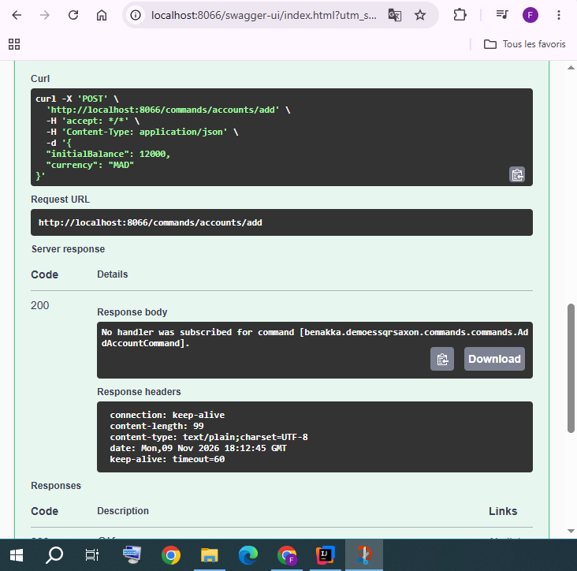
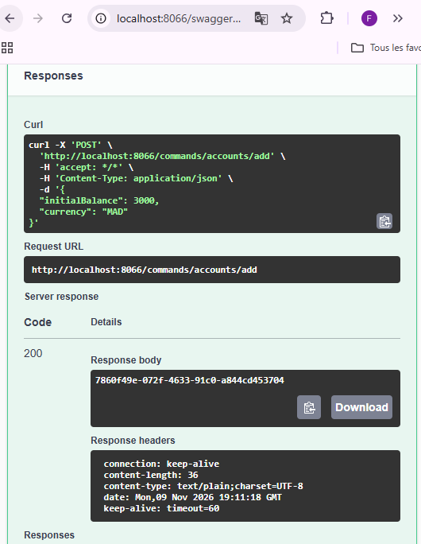
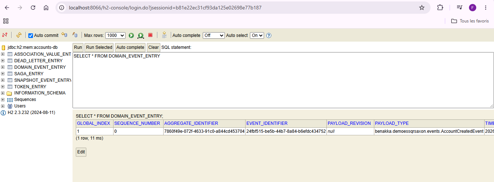
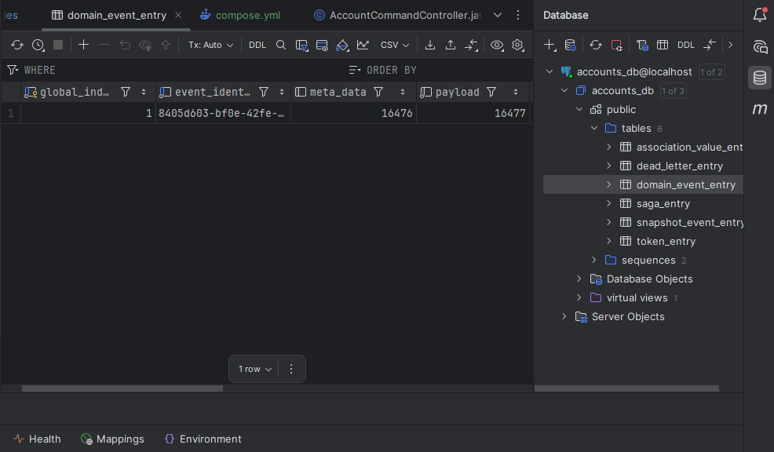
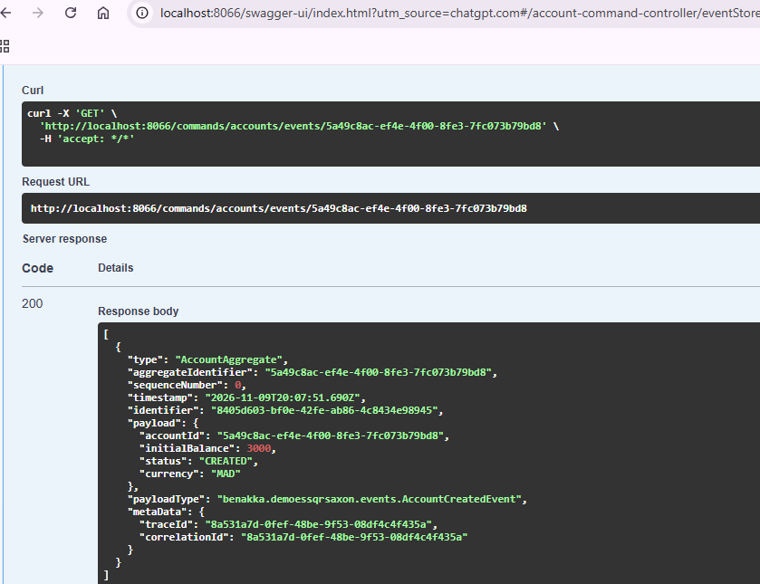
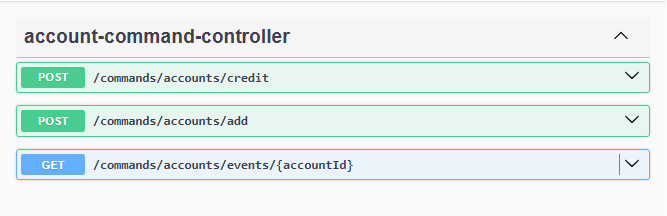
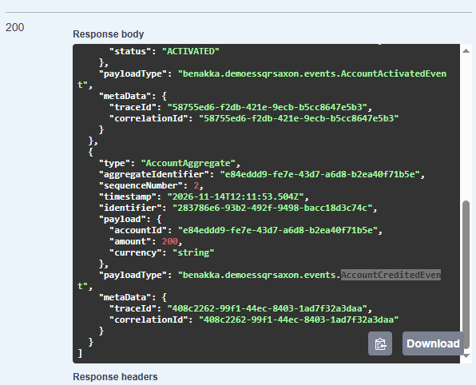

# CQRS - Event Sourcing
## 1. Développements du Côté Commande (Command Side)
## Add Account
#### Contrôleur de commande : AccountCommandController injectant CommandGateway pour expédier les commandes (Send).

#### Agrégat (AccountAggregate) : on a un id en response

#### Event Store

#### Test avec PostgreSql

#### Recuperer un event depuis event store

## Credit Account

